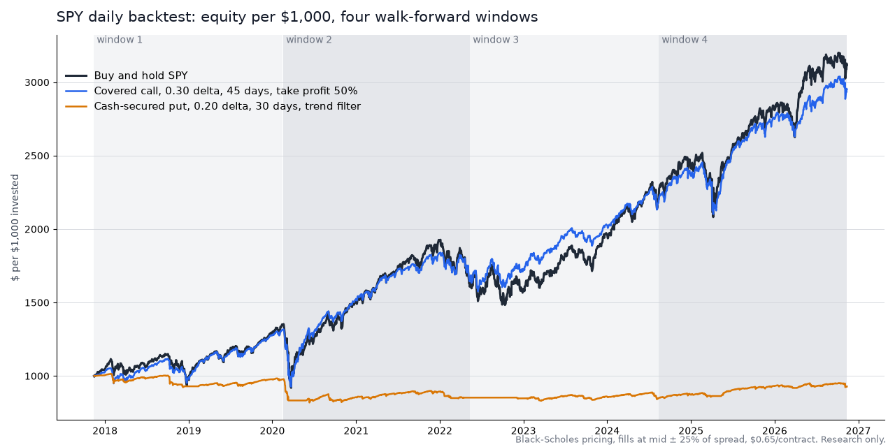

# optlab

A backtesting lab for two income options strategies, covered calls and cash-secured puts. It tests each variant on 10 years of daily prices and promotes only the ones that beat buy-and-hold on a risk-adjusted basis.


<p align="center">
  
</p>

The chart shows SPY, with equity per $1,000. A 0.30-delta covered call tracks buy-and-hold but gives up the upside on strong rallies. A trend-filtered 0.20-delta put stays flat. Neither beats buy-and-hold here, so the walk-forward gate would not advance them. To regenerate the chart, run `uv run --with matplotlib python docs/make_hero_chart.py`.

It is research only. Nothing in this repo connects to a broker or places trades.

## Features
- **Strategies are data, not code.** Each variant is a validated parameter record: delta target, days to expiry, take-profit, roll timing, volatility-rank floor, trend filter. There are 22 seed variants.
- **Daily simulation.** It sells the option, marks it to market every day, and handles take-profit, rolls, assignment, call-away and closing before earnings.
- **Conservative pricing and fills.** Black-Scholes with a continuous dividend yield. Sellers get mid minus 25% of the spread, buyers pay mid plus 25%, plus $0.65 per contract.
- **Walk-forward gate.** Each run is split into 4 out-of-sample windows. A variant passes only if it meets all of these:
  - profitable in at least 3 of the 4 windows
  - Sortino ratio better than buy-and-hold
  - max drawdown no worse than 1.25x the underlying's
  - at least 30 trades
- **Lifecycle.** Variants move from candidate to backtest_pass, then paper, then promoted, with benched and retired states.
- **Reproducible runs.** Every backtest result and run log is stored in DuckDB. The command line writes a ranked JSON report.

## Stack
- Python 3.11+, NumPy, pandas, SciPy
- DuckDB for results and run logs
- yfinance for price history, with a one-day local cache
- pytest, with [uv](https://docs.astral.sh/uv/) for environments

## Run locally
```bash
uv run python -m optlab.cli lab-run --symbols SPY,QQQ,AAPL,MSFT --db data/options.duckdb --out out/optlab_lab.json
```
This evaluates every candidate variant on each symbol, records the results in DuckDB and writes a ranked JSON report. A symbol that fails to download is skipped and listed. `data/` and `out/` are git-ignored.

## Tests
```bash
uv run --extra dev pytest -q   # 70 tests
```
The tests cover:
- pricing against known values
- the fill model
- the backtest engine, with golden results
- metrics
- walk-forward windows and the gate
- the lifecycle
- the store

## Project structure
```
optlab/
  strategy.py     Strategy record and its validation
  seed.py         the 22 seed variants
  data.py         price, dividend and earnings history (yfinance, cached)
  pricing.py      Black-Scholes with dividend yield, delta-to-strike
  fills.py        spread-aware fill model and commissions
  backtest.py     daily simulation: open, mark, take profit, roll, assign
  metrics.py      returns, Sortino, drawdown, win rate
  walkforward.py  4-window evaluation, buy-and-hold baseline, the gate
  lifecycle.py    candidate -> backtest_pass -> paper -> promoted
  store.py        DuckDB tables for strategies, results and runs
  cli.py          `lab-run` entry point
tests/            one test module per component, plus golden backtests
docs/             README chart and the script that draws it
```
A run loads history for each symbol, then evaluates every candidate variant over the four windows. Each result goes through the gate and is stored. The variant's lifecycle status moves only when it passes on at least half the symbols.
